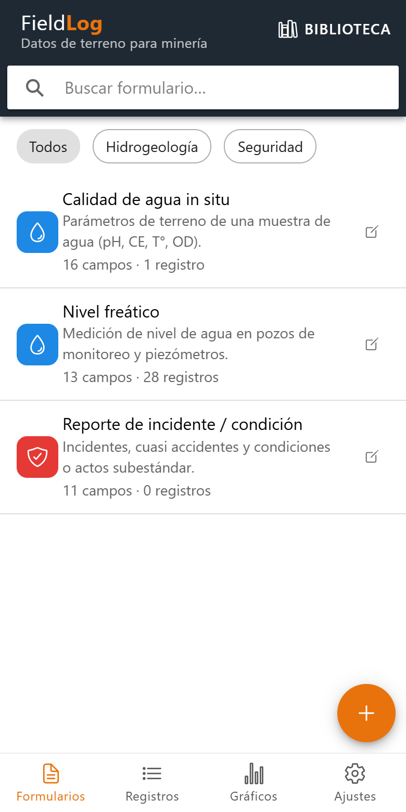
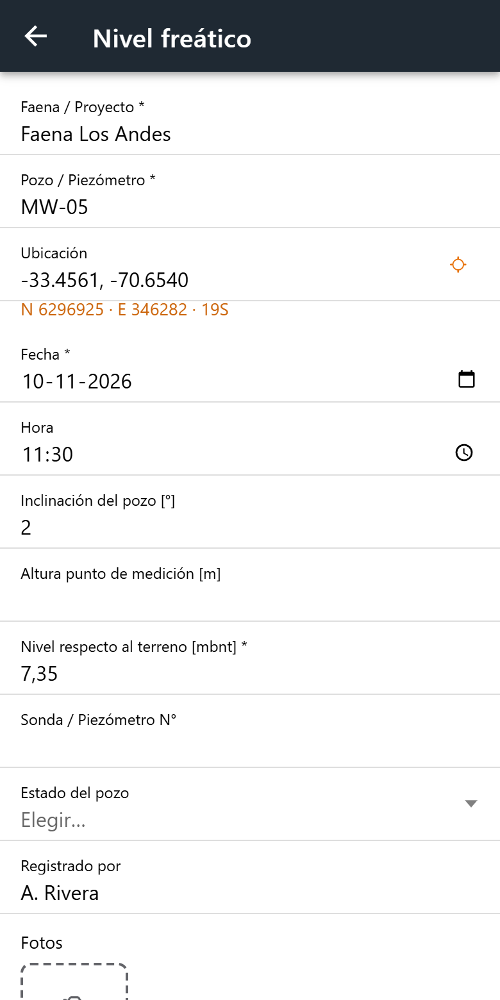
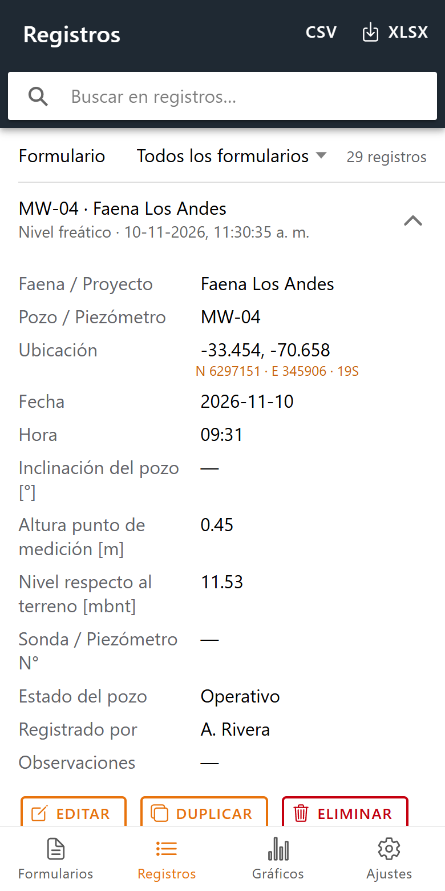
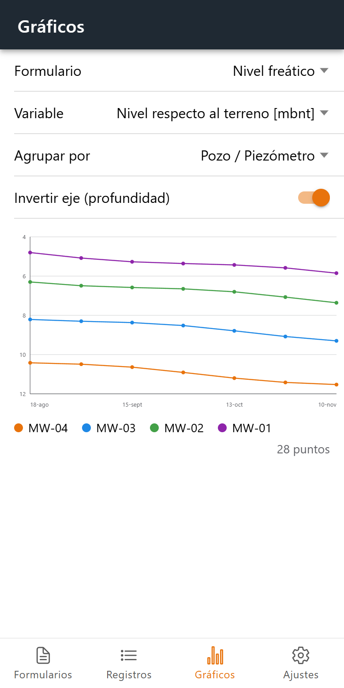
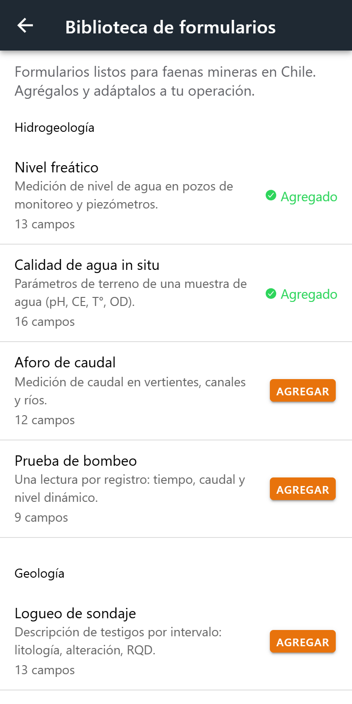
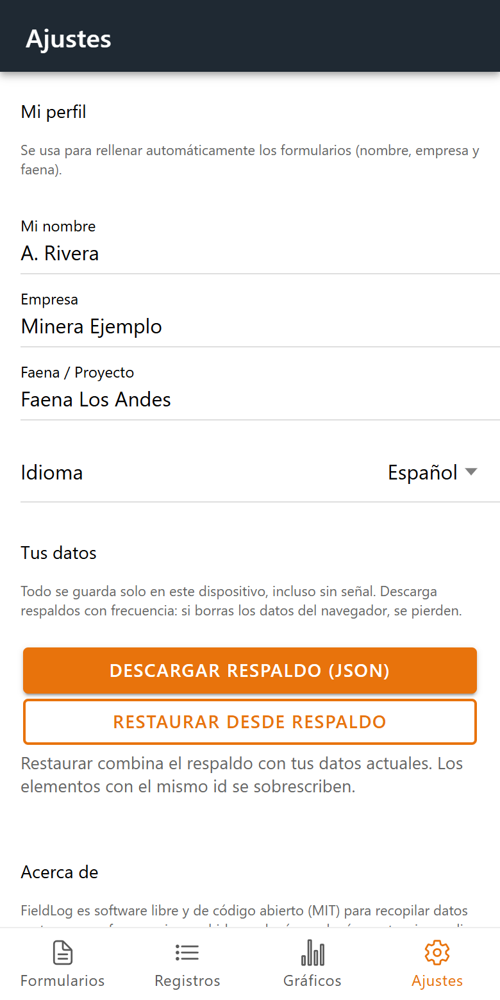

# FieldLog

**Field data collection for mining — built for Chilean operations.**
Hydrogeology, geology, geotechnics, environment, safety and operations in one free app. Works **offline**, no account, no server, no tracking: your data stays on your device.

**Live app:** https://nibrill.github.io/FieldLog/ — open it on your phone and use *Add to Home Screen* to install it.

*Español: app gratuita de código abierto para tomar datos en terreno en faenas mineras de Chile. Funciona sin señal, con coordenadas UTM, fotos, gráficos y exportación a Excel. La interfaz está en español por defecto (y en inglés).*

## Screenshots

<p align="center">
  
  
  
</p>
<p align="center">
  
  
  
</p>

## What's inside

- **Form library for mining** – ready-made forms you can add and adapt:
  - *Hydrogeology:* groundwater level, in-situ water quality, flow gauging, pumping test
  - *Geology:* drill-core log, geological mapping
  - *Geotechnics:* geotechnical (discontinuity) mapping, tailings / dump inspection
  - *Environment:* noise & dust monitoring, spill report
  - *Safety:* incident / hazard report, 5-minute safety talk
  - *Operations:* vehicle / equipment pre-use checklist
- **Your own forms** – text, number (units + usual min/max warnings), long text, date, time, choice list, yes/no, GPS and photos.
- **GPS with UTM** – tap once to capture the position; Norte / Este / Huso (WGS84 / SIRGAS-Chile, zones 18 & 19) are computed and exported as separate columns.
- **Photos** – taken or picked from the gallery, compressed automatically (~100 KB each) and stored with the record.
- **Fast data entry** – your name / company / site pre-filled from your profile, "remember last value" fields, duplicate a previous record, edit later.
- **Trend charts** – e.g. water level per well over time, with an inverted axis for depth-below-ground.
- **Export** – Excel (one sheet per form) or CSV; on phones it opens the share sheet (WhatsApp, e-mail, Drive…). Formula-injection safe.
- **Backup & restore** – one JSON file, photos included.
- **Offline-first & installable (PWA)**, light/dark mode, Spanish and English.

## Run it yourself

```bash
npm install
npm start          # http://localhost:4200
npm run build      # static site in ./www
npm test
```

The build is a plain static site: host it anywhere (GitHub Pages, an intranet server, a USB stick). It uses hash routing, so no server rewrite rules are needed. To publish with GitHub Pages: *Settings → Pages → Source: GitHub Actions* — the included workflow deploys every push to `main`.

### Android / iOS (optional)

Capacitor is preconfigured (`capacitor.config.ts`):

```bash
npm run build
npx cap add android   # or ios
npx cap sync
```

The web/PWA version is the primary target. In a native webview, file downloads may need the Capacitor Filesystem / Share plugins.

## Your data

Data is stored in the browser's IndexedDB on the device (plus the app asks the browser to keep it from being evicted). **Clearing site data deletes it — download a backup regularly** from *Settings*. There is no cloud sync by design; the data layer is isolated in `src/app/core/store.ts` if you want to add a backend.

## Adding forms for your operation

Library forms live in `src/app/core/library.ts` as plain data (Spanish + English labels). Add an entry, run the app, and it shows up in the library. Translations of the UI are in `src/app/core/i18n.ts`.

## Contributing

Issues and pull requests are welcome — especially new form templates from real operations (explosives, plant/metallurgy, maintenance, community relations…). Please run `npm test` and `npm run build` first.

## License

[MIT](LICENSE)
